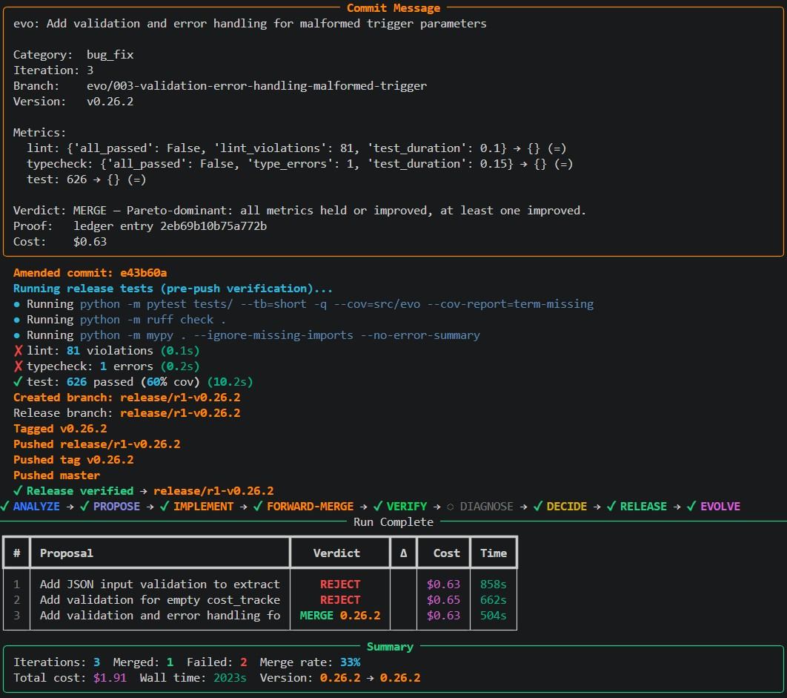

<p align="center">
  <strong>evo</strong><br>
  <em>Autonomous Software Evolution Engine</em>
</p>

<p align="center">
  <a href="https://github.com/ntholm86/evo-releases/releases/latest"></a>
  <a href="https://github.com/ntholm86/evo-releases/releases"></a>
  
  
</p>

---

**Most AI coding tools wait for you to ask.** evo doesn't wait.

Point it at any git repo. Tell it what "better" means — more tests, fewer bugs, fewer lint violations. Walk away. evo runs a **closed-loop evolution pipeline** that analyzes weaknesses, writes code, verifies nothing regressed, and merges — autonomously, with a cryptographic proof trail.

On April 4, 2026, **evo released itself.** [v0.26.2](https://github.com/ntholm86/evo-releases/releases) was analyzed, implemented, benchmarked, and published entirely by evo's own pipeline — the first version where the engine completed the full self-improvement loop without human intervention.

It doesn't just generate code. It **evolves codebases** — including its own.

---

**Contents:** [What Makes evo Different](#what-makes-evo-different) · [Install](#install) · [Quick Start](#quick-start) · [Configuration](#configuration) · [The Pipeline](#the-pipeline) · [Self-Improvement](#self-improvement) · [Strategies](#strategies) · [Models & Providers](#models--providers) · [CLI Reference](#cli-reference) · [Safety](#safety) · [Language Support](#language-support)

---

## What makes evo different

- **Zero human intervention** — analyze → propose → implement → verify → decide → merge. No prompting, no code review, no copy-paste.
- **Regression-proof** — Every change passes a Pareto gate. If *any* metric regresses — tests, lint, coverage, security — the change is rejected. Period.
- **Self-improving** — evo uses its own merge rate as a fitness function and can evolve *its own source code*. The engine that writes code can rewrite itself.
- **Self-correcting** — When tests fail, evo diagnoses whether the *test* or the *source* is wrong and auto-retries with the fix. Floating-point precision, platform-specific behavior, off-by-one errors — caught and fixed automatically.
- **Tamper-evident audit trail** — A hash-chained proof ledger records every decision. Immutable. Verifiable. Run `evo status` to check chain integrity.
- **Multi-language** — Python, TypeScript, JavaScript, C#, with automatic detection for Go, Rust, and Ruby. Auto-detects test frameworks, linters, and type checkers.
- **Multi-provider** — Anthropic (Claude) and OpenAI (GPT/o-series). Mix models per pipeline phase — cheap models for simple tasks, strong models where accuracy matters.
- **Statistically rigorous** — Noisy metrics use Welch's t-test instead of naive comparison. No false positives from measurement noise.
- **Cross-repo learning** — Diagnostic insights and success rate statistics transfer between repos, so evo gets better the more codebases it works on.

---

## Install

Download the latest `.whl` from [Releases](https://github.com/ntholm86/evo-releases/releases/latest):

```bash
pip install evo_engine-*.whl
```

Or install with OpenAI support:

```bash
pip install "evo_engine-*.whl[openai]"
```

### Requirements

- Python 3.11+
- Git (target must be a git repository)
- An LLM API key (Anthropic or OpenAI)
- Docker (optional — for sandboxed execution, or use `--no-sandbox`)

---

## Quick Start

```bash
# 1. Set your API key (the .env file is auto-loaded)
echo "ANTHROPIC_API_KEY=your-key" > .env

# 2. Run against any repo
cd /path/to/your/project
evo init                            # scaffold .evo.yaml interactively
evo run --iterations 5 --no-sandbox # let it go
```

Or try the bundled demo projects to see evo in action:

```bash
# Clone evo, then run against a demo
cd demo/mathkit
evo run --iterations 3 --no-sandbox
```

Watch evo analyze the codebase, find weaknesses, write code, run tests, and merge improvements — all on its own.

---

## Configuration

evo is configured via a `.evo.yaml` file in the target repo root. Run `evo init` to generate one interactively, or create it by hand.

### Minimal

```yaml
project: my-app
language: python
metrics:
  test: "pytest --tb=short -q"
```

That's enough. evo auto-detects available lint and type-checking tools.

### Full Example

```yaml
project: my-app
language: python

strategy: balanced              # test_coverage | hardening | balanced | full_auto
on_test_failure: auto-fix       # reject | auto-fix | human-gate

metrics:
  test: "pytest --tb=short -q"
  lint: "ruff check ."
  typecheck: "mypy . --ignore-missing-imports"

# Optional: statistical comparison for noisy metrics
#  bench:
#    command: "pytest tests/bench.py -q"
#    runs: 5
#    comparison: welch           # Welch's t-test, reject only if p < 0.05

max_files_per_change: 5
max_cost_per_run: 5.00

allowed_scopes:
  - "src/**"
  - "tests/**"

blocked_scopes:
  - ".evo.yaml"
  - "pyproject.toml"

provider: anthropic               # or: openai

models:
  default: claude-haiku-4-5-20251001
  analyze: claude-sonnet-4-20250514       # strong model for code comprehension
  implement: claude-sonnet-4-20250514     # strong model for code generation

sandbox:
  image: "python:3.12-slim"
  setup: "pip install -e '.[test]'"
```

### C# Example

```yaml
project: my-api
language: csharp

metrics:
  test: "dotnet test --no-build -v q"
  lint: "dotnet format --verify-no-changes"

allowed_scopes:
  - "src/**"
  - "Tests/**"
```

---

## The Pipeline

```
ANALYZE → PROPOSE → IMPLEMENT → FORWARD-MERGE → VERIFY → DIAGNOSE → DECIDE → RELEASE → EVOLVE
```

Nine phases, every iteration:

| Phase | What Happens |
|-------|-------------|
| **ANALYZE** | Run all metrics. LLM reads the codebase and identifies weaknesses. |
| **PROPOSE** | LLM selects the single highest-impact fix from the weakness list. |
| **IMPLEMENT** | Create a git branch, generate code, commit. Build-check with up to 3 retries. |
| **FORWARD-MERGE** | Merge master into the feature branch so tests run against current state. |
| **VERIFY** | Re-run all metrics. Compare before/after. |
| **DIAGNOSE** | If tests fail: AI classifies the issue and retries with a fix (up to 3 cycles). |
| **DECIDE** | **Pareto gate** — no metric may regress, at least one must improve. |
| **RELEASE** | Squash-merge to master, version bump, changelog, release branch, tag + push. |
| **EVOLVE** | Write proof ledger entry, update statistics, feed results into next iteration. |

### The Pareto Gate

The DECIDE phase is strict: **no metric may get worse, and at least one must get better.**

- +40 tests but +1 lint violation → **REJECT**
- +15 tests, lint unchanged → **MERGE**
- Nothing changed → **REJECT**

evo doesn't ship "probably fine." It ships "provably not worse."

### The Diagnosis Loop

When tests fail after IMPLEMENT, evo doesn't just give up:

| Diagnosis | Meaning | Action |
|-----------|---------|--------|
| `BUG_FOUND` | Real bug in the source code | Fix applied directly |
| `TEST_ASSUMPTION_WRONG` | Test has incorrect expectations | Test rewritten |
| `RISK_ESCALATION` | Change is too dangerous | Reject immediately |

This makes evo self-correcting within each iteration.

### Branch Naming

Every iteration gets a deterministic branch name:

```
evo/001-add-input-validation-to-parse-config
evo/002-test-coverage-for-metric-aggregation
evo/003-harden-error-handling-in-git-module
```

On **MERGE**, the branch is squash-merged with a structured commit message (metrics, proof hash, cost). On **REJECT**, a `DEAD END:` commit preserves the context in git history.

---

## Self-Improvement

This is what evo was built for. It can improve its own source code, using its own output quality as the fitness function.

<p align="center">
  
  <br><em>v0.26.2 self-improvement run: 3 iterations, 1 merged at 33% merge rate, $1.91 total cost.</em>
</p>

### The Loop

```
 ┌────────────────────────────────────────────┐
 │  ① BENCHMARK                               │
 │  Run evo against demo repos.               │
 │  Record merge rate as baseline score.       │
 │                 ↓                           │
 │  ② SELF-RUN                                │
 │  Run the evo pipeline on evo's own code.   │
 │  Propose and implement an improvement.     │
 │                 ↓                           │
 │  ③ RE-BENCHMARK                            │
 │  Run the same demos with modified evo.     │
 │  Compare score to baseline.                │
 │                 ↓                           │
 │  ④ VERDICT                                 │
 │  Score improved → MERGE + release.         │
 │  Score regressed → REJECT.                 │
 │                 ↓                           │
 │           (loop to ①)                       │
 └────────────────────────────────────────────┘
```

```bash
evo self-improve -n 3 --repos bugkit vulnkit mathkit --no-sandbox
```

When a self-improvement iteration passes the benchmark gate, evo merges the change, bumps its own version, tags it, and pushes — triggering CI to publish a new release. Start the command, walk away, come back to a new version.

### Self-Targeting Safety

When evo detects it's running on its own repo:

- **Safety-critical modules are locked** — decide, release, proof, git, sandbox can't be modified
- **Stronger models activate** — analyze and implement auto-escalate to Sonnet
- **Benchmark gating** — changes must improve the score across demo repos, not just pass evo's own tests
- **Lessons memory** — failed approaches are recorded so evo doesn't repeat them

### Cross-Repo Learning

evo builds knowledge that transfers between codebases:

- **Lessons** — diagnostic insights (test failures, platform quirks) are shared across repos within a benchmark run
- **Genomes** — statistical success rates per proposal category, language, and coverage level — injected into prompts so the LLM prioritizes what actually works

Manage with `evo lessons` and `evo genomes`.

---

## Strategies

| Strategy | Focus | Writes Source? | Best For |
|----------|-------|:-:|----------|
| `test_coverage` | Missing tests, edge cases | No | Safe first pass — grow coverage |
| `hardening` | Bugs, error handling | Yes | Making code robust |
| `balanced` | Tests + bugs + quality | Yes | General improvement |
| `full_auto` | Everything — LLM decides | Yes | Maximum autonomy |

Start with `test_coverage` to build confidence, then move to `balanced` or `hardening`.

---

## Models & Providers

evo supports **Anthropic** (Claude) and **OpenAI** (GPT/o-series). Each pipeline phase can use a different model:

```yaml
provider: anthropic                       # or: openai
models:
  default: claude-haiku-4-5-20251001      # cheap fallback for simple tasks
  analyze: claude-sonnet-4-20250514       # code comprehension needs depth
  implement: claude-sonnet-4-20250514     # code quality matters here
```

| Phase | Task | Recommendation |
|-------|------|---------------|
| `analyze` | Find weaknesses | Strong model (Sonnet/GPT-4o) |
| `propose` | Pick one improvement | Cheap model (Haiku/GPT-4o-mini) |
| `implement` | Write code | Strong model |
| `diagnose` | Analyze test failures | Cheap model |

**Typical cost per iteration:** $0.02–0.05 (all cheap), $0.06–0.15 (strong for analyze+implement).

If you omit the `models` section, all phases default to the cheapest available model.

---

## CLI Reference

### Core

```
evo run                             Run the improvement loop
evo run -n 10                       10 iterations
evo run --no-sandbox                Run locally (no Docker)
evo run --strategy hardening        Override strategy
evo run -r /path/to/repo            Target a specific repo
evo run --verbose                   Detailed output
evo run --show-prompts              Display LLM prompts
```

### Setup & Inspection

```
evo init                            Scaffold .evo.yaml interactively
evo analyze                         One-shot: run metrics + find weaknesses
evo status                          Proof ledger summary + chain verification
evo history                         Full proof ledger with metric deltas
evo lessons                         Diagnostic insights from past runs
evo runs                            List past runs (merge rate, cost)
evo stats                           Aggregate statistics
evo cleanup --older-than 30d        Remove stale evo branches
```

### Benchmarking

```
evo benchmark                       Run suite across demo repos
evo benchmark --save my-baseline    Save results as named baseline
evo benchmark --compare my-baseline Compare to a saved baseline
evo benchmark --parallel            All repos in parallel (faster)
evo benchmark --score-only          JSON output for scripting
```

### Self-Improvement

```
evo self-improve                    Full loop: benchmark → self-run → re-benchmark
evo self-improve -n 5               5 self-improvement iterations
evo self-improve --repos bugkit vulnkit   Benchmark specific repos
evo self-improve --demo-iterations 5      Iterations per demo repo
evo self-improve --force-baseline         Re-run baseline even if cached
```

### Knowledge

```
evo genomes                         Cross-repo success rate data
evo genomes --prune                 Remove proven failures
evo lessons --clear                 Reset the lessons journal
```

---

## Safety

Safety in evo is structural, not bolted on.

| Mechanism | What It Does |
|-----------|-------------|
| **Pareto gate** | No metric may regress. Ever. |
| **Scope enforcement** | AI can only touch files in `allowed_scopes`. `test_addition` proposals are further restricted to test files only. |
| **Proof ledger** | Hash-chained append-only log. Each entry's hash depends on the previous. Tampering breaks the chain. |
| **Cost caps** | Configurable per-run spending limits. |
| **Docker sandbox** | Optional isolated execution (or `--no-sandbox` for local). |
| **Dead-end commits** | Rejected changes are committed with `DEAD END:` messages — nothing is silently lost. |
| **No force-push** | Append-only git history. No rebase, no `--force`. |

### Failure Handling

| Mode | Behavior |
|------|----------|
| `reject` | Dead-end immediately on failure (safest) |
| `auto-fix` | AI diagnoses and retries — up to 3 cycles |
| `human-gate` | AI diagnoses, human approves before fix |

---

## Language Support

Built-in profiles:

| Language | Test Frameworks | Lint | Type Check |
|----------|----------------|------|------------|
| Python | pytest | ruff, flake8 | mypy |
| TypeScript | vitest, jest | eslint | tsc |
| JavaScript | vitest, jest | eslint | — |
| C# | dotnet test (xUnit, NUnit) | dotnet format | — |

Additional parsers: Go (`go test`), Rust (`cargo test`), Ruby (Minitest).

For unknown languages, evo can **infer a profile via LLM** — detecting test patterns, build commands, and file conventions — then cache it for future runs.

---

## License

MIT — Copyright (c) 2025-2026 Nils Wendelboe Holmager
